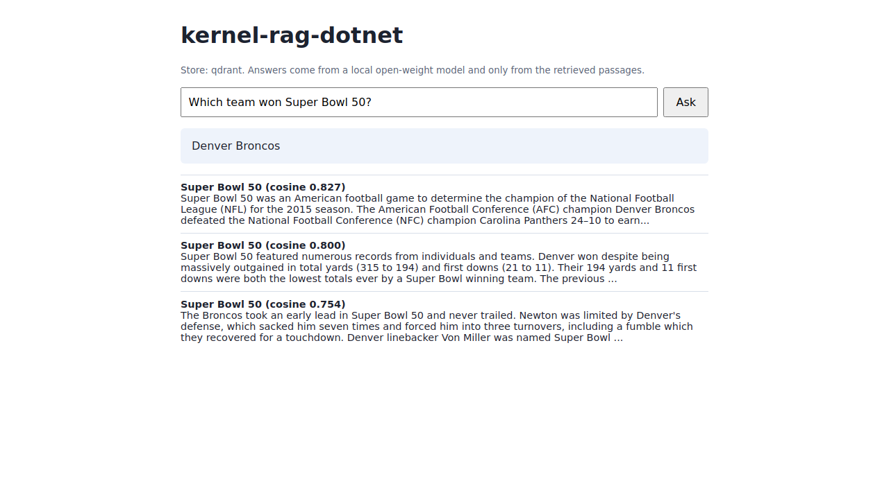

# kernel-rag-dotnet

A RAG assistant in C# on ASP.NET Core (.NET 8), built with Microsoft Semantic Kernel and local Ollama. No cloud services.
One `IVectorStore` interface has real implementations for Qdrant, Weaviate and Elasticsearch, and an evaluation compares them on identical data.

## Results

Measured in [GitHub Actions run 42541602496](https://github.com/ryannaidji/kernel-rag-dotnet/actions/runs/42541602496); raw output in [`evals/results/latest.json`](evals/results/latest.json).
Conditions: one GitHub-hosted `ubuntu-latest` runner (4 vCPU, 15.6 GB, no GPU), 2,067 SQuAD passages, 500 questions, `nomic-embed-text` (768 dimensions), one single-threaded client on the same host as the containers, k=10 fetched, 50 warm-up queries excluded.

| Store | recall@1 | recall@5 (95% CI) | recall@10 | MRR | Indexing, median of 3 | Query p50 | Query p95 |
|---|---|---|---|---|---|---|---|
| Qdrant 1.13.6 | 0.750 | 0.950 (0.927-0.966) | 0.972 | 0.832 | 1.19 s | **1.47 ms** | **1.76 ms** |
| Weaviate 1.30.3 | 0.748 | 0.948 (0.925-0.964) | 0.970 | 0.830 | 1.51 s | 4.50 ms | 7.09 ms |
| Elasticsearch 8.17.4 | 0.750 | 0.950 (0.927-0.966) | 0.972 | 0.832 | 1.40 s | 5.02 ms | 6.93 ms |
| Exact in-memory (baseline) | 0.750 | 0.950 (0.927-0.966) | 0.972 | 0.832 | n/a | 2.34 ms, no network | 3.41 ms, no network |

**Which store won what, on this runner only:**

- **Retrieval quality: no winner.** Qdrant and Elasticsearch matched exact search. Weaviate differed by one question out of 500 at recall@5, well inside the confidence interval. At this size, recall is limited by the embeddings, not by the index.
- **Query latency: Qdrant**, about 3x faster at p50 and about 4x at p95 than the other two. An earlier run of this workflow showed the same order (p50 of 1.55, 4.63 and 5.13 ms). Weaviate and Elasticsearch are close to each other.
- **Indexing time: no meaningful winner.** All took 1.2-1.5 s for 2,067 vectors, and trial-to-trial spread is similar in size to the differences between stores.

**Answer groundedness** (25 questions, `qwen2.5:1.5b` answers, `qwen2.5:3b` judge): all three stores returned the same top-5 passages for every sampled question, so their scores are identical and this says nothing about the stores.

| Metric | Value |
|---|---|
| Answers judged supported by the context | 0.80 (20/25) |
| Mean share of answer content words found in the context | 0.963 |
| Answers containing a SQuAD gold answer | 0.80 (20/25) |
| Answers abstaining | 0 of 25 |
| Control: judge said YES for an unrelated context | 0 of 25 |

The small generator never abstained, and a previous run of the same sample gave 0.88 for gold-answer containment, so generation is not fully repeatable even at temperature 0. With n=25, treat these as rough.

CI gate: `eval` fails if any store's recall@5 is below 0.92 ([`evals/thresholds.json`](evals/thresholds.json)), chosen just under the lowest 95% lower bound measured (0.925).

## Demo



The screenshot and [`docs/demo_output.json`](docs/demo_output.json) were recorded in CI, from the API running against Qdrant and Ollama.

## Architecture

```
Browser UI / HTTP --> ASP.NET Core minimal API --> RagService (Semantic Kernel)
                                                     |-- Ollama: nomic-embed-text, qwen2.5:1.5b
                                                     '-- IVectorStore: Qdrant | Weaviate | Elasticsearch | exact in-memory
```

- `src/KernelRag.Core`: RAG pipeline, chunker, metrics, groundedness scoring, store implementations.
- `src/KernelRag.Api`: `POST /api/ingest`, `POST /api/ask`, `GET /api/health`, and a small web page.
- `src/KernelRag.Eval`: data preparation and the store comparison.
- `tests/KernelRag.Tests`: xUnit unit and API tests, plus contract tests that run against real containers in CI.

The stores are called over their HTTP APIs through one shared `HttpClient` path, rather than through three different client libraries.

## How the comparison is designed

- Every store receives the same vectors, embedded once.
- All use cosine HNSW with m=16, ef_construction=100, ef_search=100, without quantization or keyword indexing.
- Qdrant's thresholds are lowered, because its defaults would answer this small collection by exact scan.
- Indexing is timed over 3 trials, up to the point the index is searchable. The median is reported.
- 50 warm-up queries are excluded. Stores are queried in rotating order per question, to spread runner drift evenly.
- An exact in-memory search provides the recall ceiling for these embeddings. Its latency is not comparable, because it makes no network call.
- Groundedness (`workflow_dispatch` only): `qwen2.5:1.5b` answers from the top 5 passages and `qwen2.5:3b` judges support. A control judges answers against unrelated context, to show how far the judge can be trusted. A lexical score and gold-answer containment are reported alongside it.

## Data

`data/` holds SQuAD 1.1 dev: 2,067 Wikipedia passages and 500 human-written questions (one per passage, sampled with seed 42).
Source: <https://rajpurkar.github.io/SQuAD-explorer/>. License: CC BY-SA 4.0, see `data/NOTICE.txt`. Nothing is synthetic.

## Run

```
dotnet test KernelRag.sln
docker compose up --build        # API on :8000, Qdrant; Ollama expected on the host
```

Set `Store__Provider` to `qdrant`, `weaviate`, `elasticsearch` or `memory`.

## Limitations

- **This is not a production benchmark.** It is one shared CI runner, a single-threaded client and 2,067 vectors, with no concurrent load, filtering, replication or large collections. A different engine could win under any of those.
- All three containers ran at once, with Elasticsearch limited to a 1 GB heap. Apart from the shared HNSW parameters, no engine was tuned.
- Latency is client-observed and includes each engine's API overhead. Qdrant and Elasticsearch use JSON REST; Weaviate uses GraphQL. Official clients or gRPC could change the ordering.
- Elasticsearch was not force-merged after indexing, so it may search more than one segment.
- The groundedness sample is small, its judge is a 3B local model, and it cannot compare stores on this data.
- Each SQuAD question is labeled with one passage, so another passage that also answers it counts as a miss.
- The API has no authentication and is a demo only.
